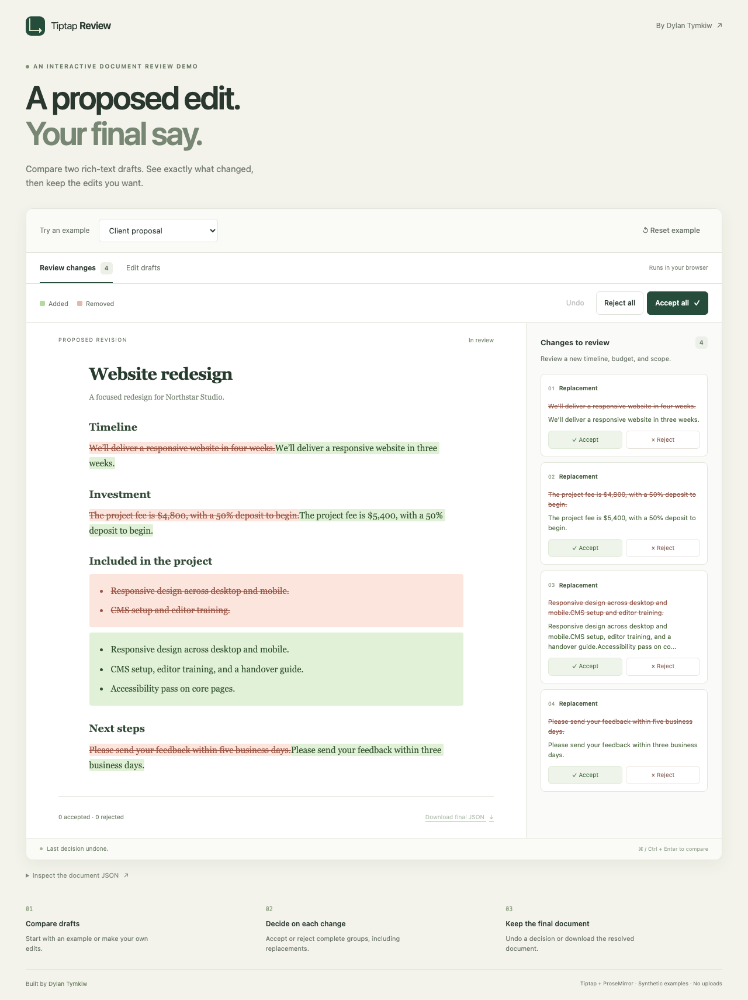

# Tiptap Document Review

Compare two rich-text drafts, review complete change groups, and accept or reject edits while preserving document structure.

**[Try the live demo →](https://tymkiwdylan.github.io/tiptap-document-review/)**

[](https://github.com/tymkiwdylan/tiptap-document-review/actions/workflows/demo.yml)

Built by [Dylan Tymkiw](https://github.com/tymkiwdylan). The review engine was extracted from document workflows developed for iAlex, then isolated into this project with synthetic examples and its own tests.



## What you can try

- Three examples: a client proposal, release notes, and formatting / structure changes.
- Editable original and proposed drafts, with bold, italic, heading, and list controls.
- Added and removed content displayed in a real Tiptap editor.
- Accept or reject one complete change group, or all remaining groups.
- Undo decisions and download the final ProseMirror JSON document.
- Inspect pending change wrappers and compare your own edits.

Changing either draft marks the previous review as stale until you compare again. Downloads become available when every change is decided. The demo runs in the browser with no backend, account, API key, or uploads.

## Run locally

Tested with Node.js 24 and pnpm 11.25.0.

```sh
pnpm install --frozen-lockfile --ignore-scripts
pnpm dev
```

Open `http://localhost:5173`.

## Build a portable demo

```sh
pnpm build:demo
```

`demo-dist/index.html` includes its JavaScript and CSS. Open the file directly, share it, or serve it on static hosting. The GitHub Pages workflow deploys this same build after verification.

## Engine API

```ts
import {
  buildTrackedDocument,
  resolveTrackedDocument,
} from 'tiptap-document-review';

const review = buildTrackedDocument(originalJson, proposedJson);

if (review.ok) {
  const accepted = resolveTrackedDocument(review.document, 'accept');
  const rejected = resolveTrackedDocument(review.document, 'reject');
}
```

`createReviewExtensions()` exposes the shared Tiptap schema extensions. `collectChangeDecisionGroups()` and `createAtomicChangeDecisionTransaction()` support decisions on individual groups, as used in the demo session model.

The package is published as source on GitHub; it is not currently distributed on npm. Build it with `pnpm build` to use the ESM output and TypeScript declarations in `dist/`.

## Verification

```sh
pnpm test
pnpm build
pnpm smoke
pnpm build:demo
pnpm exec playwright install chromium
pnpm test:browser
```

- **24 unit tests:** the original diff contracts and demo-session behavior, including accept/reject reversibility, mixed decisions, stale groups, and undo.
- **6 browser tests:** real editing and formatting, individual and bulk decisions, undo, downloads, all examples, and mobile layout.
- **Built-package checks:** ESM exports and accept/reject round trips through the public entry point.

Browser tests run against the generated standalone demo. GitHub Actions performs these checks before a Pages deployment.

## Scope and tradeoffs

This compares snapshots using a fixed editor schema. Changes are grouped semantically; a replacement's added and removed sides are resolved together. It is not a live keystroke-tracking or collaborative merge system.

The engine validates inputs, applies size/node limits, and verifies that accepting or rejecting all changes reconstructs the appropriate document. Unsupported operations return explicit failures instead of silently accepting an edit. The demo preserves drafts when comparison fails.

Custom schemas and CommonJS distribution are outside the current scope. The demo data is synthetic and browser edits are held in memory without persistence.

## Project layout

| Location | Purpose |
| --- | --- |
| `src/diff` | Snapshot comparison, tracked documents, and compatibility helpers |
| `src/tiptap` | Schema, change nodes, and atomic decision operations |
| `demo` | Browser interface, samples, session model, and tests |
| `scripts` | ESM smoke checks and standalone HTML builder |
| `.github/workflows/demo.yml` | Verification and GitHub Pages deployment |

## License and attribution

[Apache-2.0](LICENSE). See [NOTICE](NOTICE) and [PROVENANCE.json](PROVENANCE.json) for extraction context. Dependencies retain their own licenses. This is an independent project, separate from Tiptap's commercial products.
